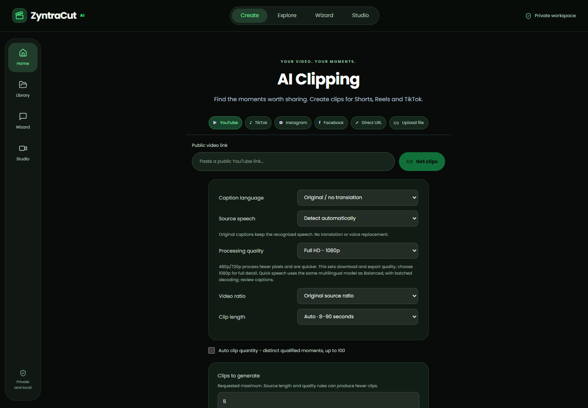
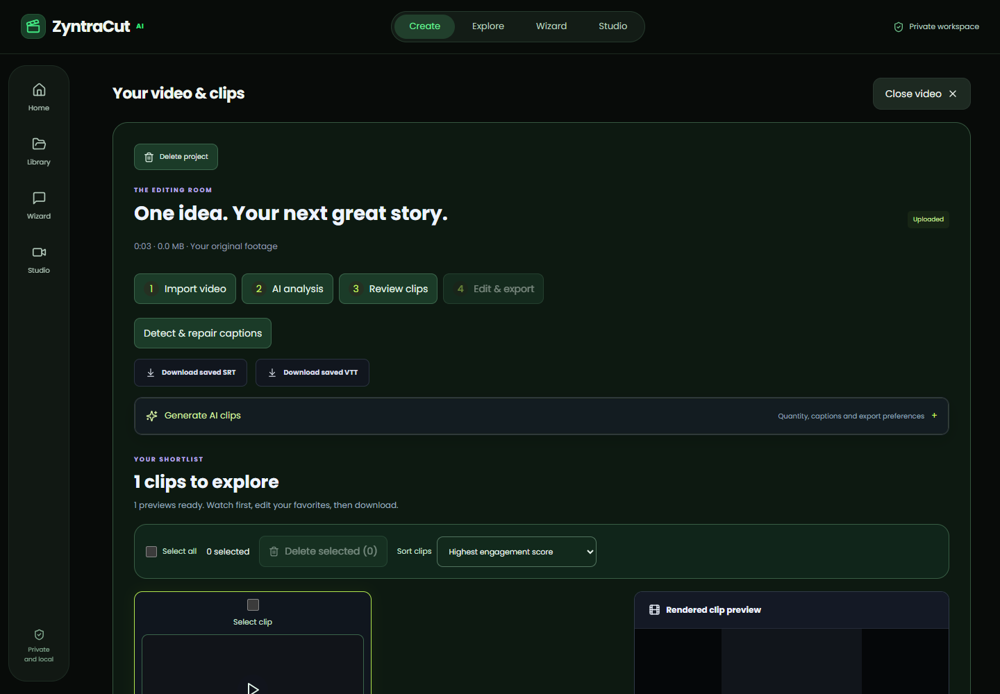
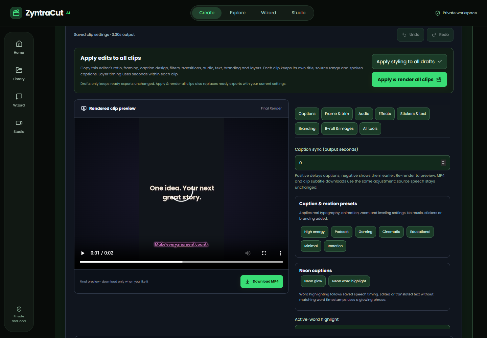
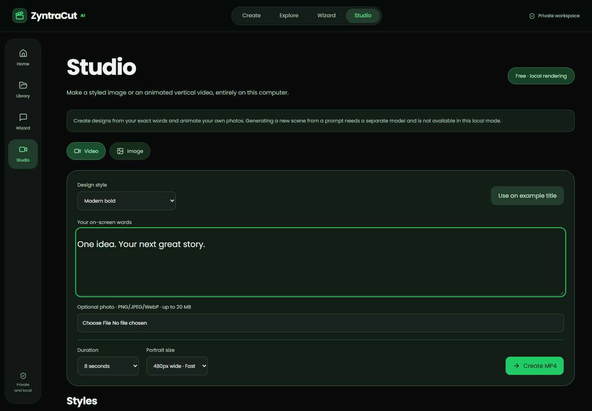
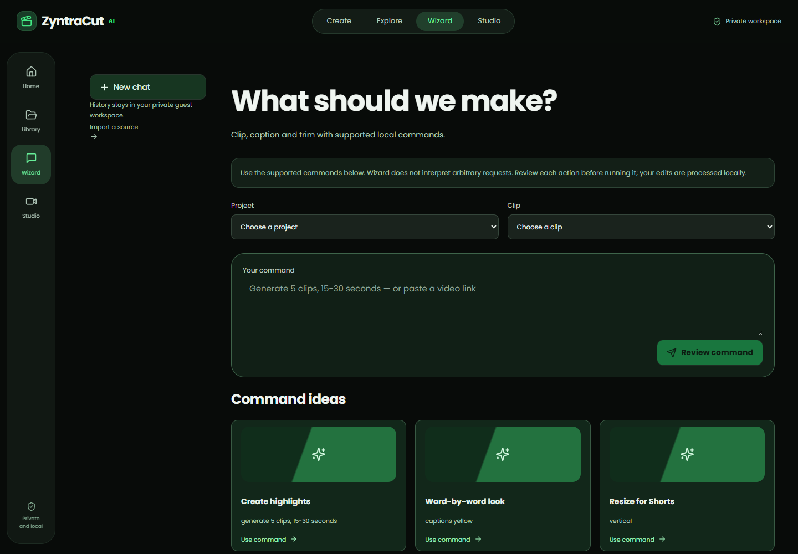

# ZyntraCut AI

A local video clipping and editing tool. Import a video, select highlights, edit
captions and framing, then render and download your clips. The frontend and
backend are kept in separate folders.

## Project folders

```text
zyntra-cut-ai/
├── frontend/                # Next.js, React, TypeScript, editor UI and browser tests
│   ├── app/
│   ├── lib/
│   ├── public/fonts/
│   ├── tests/
│   ├── package.json
│   └── .env.example
├── backend/                 # FastAPI, FFmpeg, speech, translation and Python tests
│   ├── main.py
│   ├── media.py
│   ├── scripts/
│   ├── tests/
│   ├── requirements.txt
│   ├── run.py
│   └── .env.example
├── docs/
│   ├── screenshots/         # Actual app screenshots
│   ├── DEPLOYMENT.md
│   └── archive/             # Earlier audits and implementation notes
└── README.md
```

Private videos, SQLite records, model downloads and voice tools are stored in
the ignored `data/` directory at the repository root. They are not uploaded to
GitHub. An existing local workspace keeps the same data location and projects.

## Requirements

- Python 3.11–3.13 and Node.js 22.19 or newer.
- Internet for npm/pip installation, public video imports and initial model downloads.
- Local speech recognition and rendering use your computer's CPU/RAM. Long videos
  can take substantial time; start with one short test clip.

## Run on Windows

Clone the repository, then open **two PowerShell terminals** in its folder.

**Terminal 1 — backend**

```powershell
cd backend
py -m venv .venv
.\.venv\Scripts\python.exe -m pip install -r requirements.txt
.\.venv\Scripts\python.exe run.py
```

The API runs at `http://127.0.0.1:8000`. Its API documentation is at
`http://127.0.0.1:8000/docs`. Keep this terminal running.

**Terminal 2 — frontend**

```powershell
cd frontend
npm ci
npm run dev
```

Open **http://127.0.0.1:3000** in Microsoft Edge or your preferred browser.
Both terminals must remain running while importing or rendering videos.

On macOS/Linux, use `python3 -m venv .venv` and `.venv/bin/python` for the Python
commands; the frontend commands are the same.

## How to use

1. Open **Create**. Upload your own video or paste a supported public video URL.
2. Choose the maximum clip count, duration and ratio: Original, 9:16, 1:1, 16:9 or 4:5.
3. Leave speech detection on **Auto**, or choose the language actually spoken.
   Select your desired caption language separately. Output language never forces
   unrelated speech recognition; Original keeps native captions.
4. Click **Create AI Clips**. Processing and results stay on the same page.
5. Preview clips and open a clip to edit captions, effects, text, logos, audio or images.
   **Apply edits to all clips** can copy styling across the project.
6. Render the changes, preview the finished video, then click Download.

In a clip, open **Audio & sound effects**. Ten built-in effects have an audio
preview, volume and start time in exported-clip seconds. Use **Apply & render**
to mix the chosen effect with original or dubbed speech and optional music.

The requested clip count is a maximum. If only four distinct moments qualify,
the tool returns four and explains the shortfall. It does not duplicate footage
to fill a requested count. Engagement scores are heuristics, not promised views.

For incorrect captions, use **Transcript → Spoken language → Re-transcribe audio**,
or **Detect & repair captions**. Review names, wording and sentence timing before
exporting. Keep browser cookies to retain access to your private guest workspace.

## Optional local translation and voices

Run these in `backend/` after installing its dependencies:

```powershell
# Recommended multilingual captions (M2M100 CPU INT8, approximately 494 MB):
.\.venv\Scripts\python.exe run.py setup-multilingual

# Install English/Urdu/Hindi caption translation models once:
.\.venv\Scripts\python.exe run.py setup-translation

# Install a configured additional pair, for example English to Spanish:
.\.venv\Scripts\python.exe run.py setup-translation --pairs en:es

# Windows: install the lightweight offline voice engine locally:
.\.venv\Scripts\python.exe run.py setup-dubbing
```

On Linux, install `espeak-ng` with the operating system package manager.
Then open **Transcript → Translate captions + voice**. Only installed translation
routes and supported offline voices are offered. This produces basic synthetic
speech timed to sentence slots and replaces the original audio, including music.
The main player switches to the dubbed video when ready. Compare original audio
or download the complete dubbed MP4; existing clip exports can be rendered with
the same track. Edited captions require regenerating the voice. M2M100 runs
locally and supports more translation pairs, including Punjabi, Sindhi and
Pashto captions. Voices are a separate capability: the bundled engine has no
Pashto voice. Low-resource translation can be poor; compare translated text with
the saved source and edit it before regenerating the voice.
**It does not clone voices or animate the speaker's lips.** Native caption choices
do not mean every language can be translated. Review recognition and translation.

## Screenshots

These are captures of the running app in an isolated guest workspace. The sample
title video was created by local Studio; no private user footage is shown.

| Create | Clip results |
| --- | --- |
|  |  |

| Visual editor | Local Studio |
| --- | --- |
|  |  |



Wizard runs supported editing commands; Studio makes title designs and animated
photo/text videos. They do not claim general conversational AI or photorealistic
prompt-to-video generation.

## Tests and production build

```powershell
# From backend/:
.\.venv\Scripts\python.exe run.py test -q

# From frontend/:
npm run typecheck
npm run test:config
npm run build
npm run start
```

For browser tests, first run both services, then run `npm run test:e2e` inside
`frontend/`. Optional speech fixture/model setup and test details are in
[backend/README.md](backend/README.md), [frontend/README.md](frontend/README.md)
and [docs/VALIDATION.md](docs/VALIDATION.md).

## Deployment

For Vercel, set **Root Directory = `frontend`** and configure the real processing
backend's public HTTPS origin as `CLIPFORGE_API_ORIGIN`. The Python backend needs
a separate persistent server with writable storage. Vercel alone does not host
the long-running FFmpeg/speech jobs. See [deployment instructions](docs/DEPLOYMENT.md).

Public-link imports depend on the source website. Login-only, DRM, deleted,
region-restricted or bot-blocked videos may fail; upload a video file instead.

Bundled fonts and other dependencies have their own licenses; see
[THIRD_PARTY_NOTICES.md](THIRD_PARTY_NOTICES.md).
